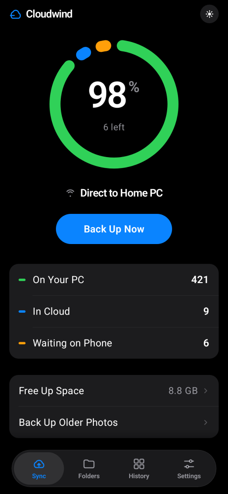
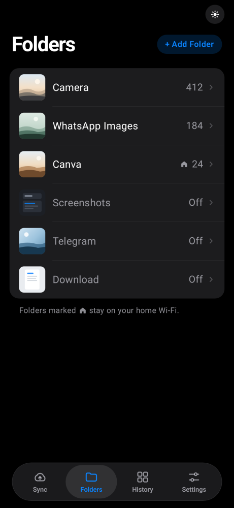
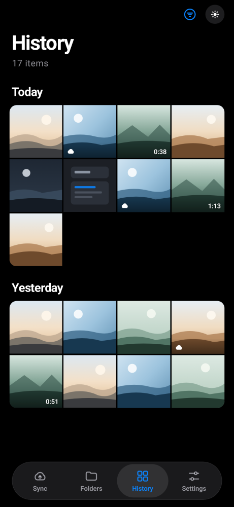
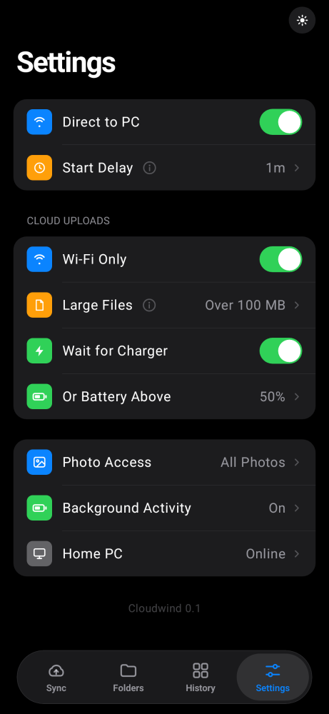
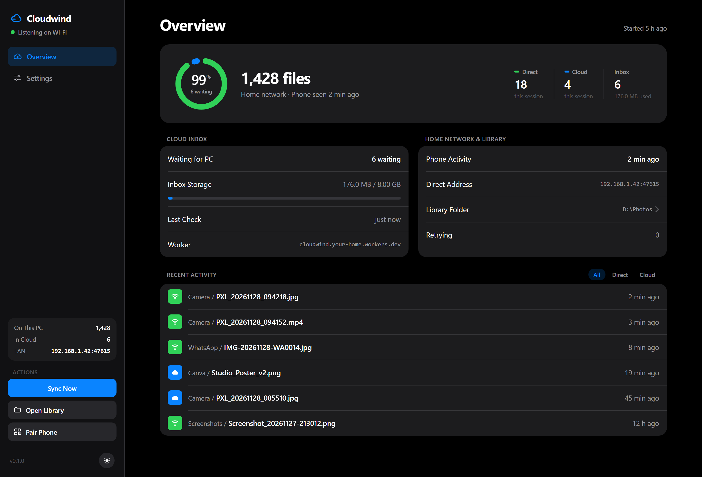
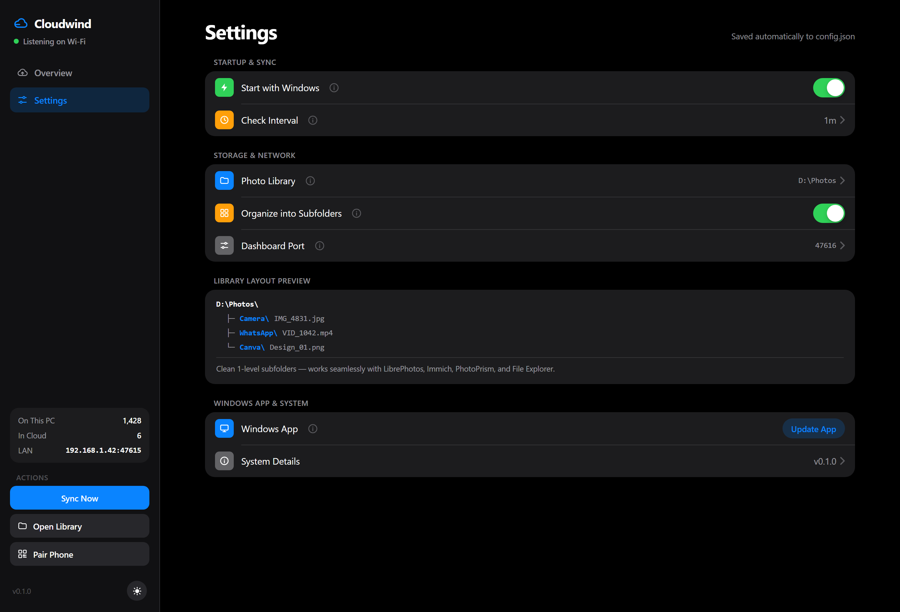

# Cloudwind

**Back up your phone's photos to your own PC, even when the PC is off.**

Cloudwind sends your photos and videos from an Android phone to a folder on your home PC. When you're home, they go
straight across your Wi-Fi. When you're away, or the PC is off, they wait in a small encrypted cloud inbox that you own,
and the PC collects them the next time it's on. Once your PC has a verified copy, the phone tells you it's safe to delete.

Your photo app (Immich, LibrePhotos, PhotoPrism, Nextcloud, or plain File Explorer) just reads that folder.

<p>
  
  
  
  
</p>

<p>
  
</p>

<details>
  <summary>PC Dashboard — Settings &amp; Subfolder Layout Preview</summary>
  <p>
    
  </p>
</details>

## Why Cloudwind

- **Your photos end up on your PC, not in someone else's cloud.** The cloud is only a waiting room. It empties itself
  once your PC has the photos.
- **Nothing readable ever leaves your phone.** Photos are encrypted on the phone before upload. The cloud never sees a
  photo, a file name or a date.
- **Fast and free at home.** On the same Wi-Fi, photos go directly to the PC: any size, no cloud limits, and nothing
  leaves the house.
- **Costs nothing to run.** The inbox runs on Cloudflare's free plan, and Cloudwind keeps itself under the free limits.
- **Safe "Free up space".** The phone only offers to delete photos your PC has checked byte for byte, and deleted photos
  go to the phone's trash, where you can restore them for 30 days.

## How it works

```
                 at home, same Wi-Fi
   Phone  ───────────────────────────────►  PC  ──►  your photo folder ──► your photo app
     │            (direct, encrypted)        ▲
     │                                       │
     └──►  your cloud inbox (encrypted)  ────┘
            when you're away or the PC is off;
            emptied once the PC has the photos
```

1. **The phone notices a new photo** and encrypts it.
2. **If your PC is reachable on the home network**, the photo goes straight to it.
3. **Otherwise it goes to your cloud inbox.** By default, big videos wait for Wi-Fi and enough battery.
4. **The PC agent** receives direct transfers and pulls from the inbox. It decrypts each photo, checks it matches what
   the phone sent, and saves it to your photo folder.
5. **The phone hears back** that the PC has the photo. It then counts it as "safe to delete", and the cloud copy is
   cleaned up.

## What you need

- An **Android phone** running Android 11 or newer. (No iPhone app; iOS limits background work too much.)
- A **PC** that's on sometimes: Windows, Linux or macOS.
- A free **Cloudflare account** for the cloud inbox.
- For now, you build both apps yourself (see [Build from source](#build-from-source)). There are no ready-made downloads
  yet.

## Setup

### 1. Create your cloud inbox (once)

This runs from any computer with [Node.js](https://nodejs.org) installed. You need two random tokens: one for the phone,
one for the PC. `openssl rand -hex 32` makes one (Git Bash on Windows has `openssl`).

```sh
cd worker
npm install
npx wrangler login                                    # opens the browser to sign in to Cloudflare
npx wrangler r2 bucket create cloudwind-inbox
npx wrangler d1 create cloudwind-status               # copy the printed database_id into wrangler.toml
npx wrangler d1 execute cloudwind-status --remote --file=schema.sql   # fresh installs need only this
npx wrangler deploy                                   # prints your URL: https://cloudwind.<you>.workers.dev
npx wrangler secret put PHONE_TOKEN                   # paste the phone token
npx wrangler secret put AGENT_TOKEN                   # paste the PC token
```

Tip: in the Cloudflare dashboard, set up a usage notification for R2 so nothing can surprise you.

### 2. Set up the PC

Build the agent (see [Build from source](#build-from-source)), then in PowerShell:

```powershell
$env:CLOUDWIND_AGENT_TOKEN = "<PC token>"
$env:CLOUDWIND_PHONE_TOKEN = "<phone token>"
.\cloudwind.exe init --library D:\Photos --worker-url https://cloudwind.<you>.workers.dev
.\cloudwind.exe pair --svg pair.svg
.\cloudwind.exe run
```

- **`init`** creates your settings and your **library key**. Write the key down somewhere safe: it's what decrypts
  photos that are still in the cloud. `--library` is the folder your photos will land in; pick any folder you like.
- **`pair`** shows a QR code for the phone. If it looks garbled in the console, open `pair.svg` in a browser instead.
  The code contains your key, so don't share a screenshot of it.
- **`run`** is the part to leave running. It receives photos from the phone and pulls from the cloud every minute.
- **Windows Firewall** will ask about `cloudwind` the first time. Allow it, or the phone can't reach the PC directly.
  If your home Wi-Fi is set to "Public" in Windows, allow it on Public networks, or switch the network to "Private".

Settings live in `%USERPROFILE%\.config\cloudwind\config.json` (`~/.config/cloudwind` on Linux and macOS).

### 3. Set up the phone

1. **Install the app** (`app-debug.apk`) and open it.
2. **Tap Scan QR code** and scan the code from your PC.
3. **Allow photos and videos.** Choose **Allow all**. With "Select photos", Cloudwind can only back up the ones you
   picked, and the app will say so.
4. **Allow notifications.**
5. **Tap Battery settings** and set Cloudwind to **Unrestricted**. This matters most: without it, many phones stop
   background backups after a while.

That's it. Take a photo: within about a minute it should be in your photo folder, and the app shows
**"PC found on your home network"**.

## Using Cloudwind

**On the phone**

| Control | What it does |
| --- | --- |
| **Back up now** | Starts a pass right away instead of waiting. Cloudwind also runs automatically whenever new photos finish saving and every 15 minutes as a safety net. |
| **Back up older photos** | By default only photos taken after pairing are backed up. This adds your existing library, newest first. |
| **Free up space** | Moves photos your PC has verified to the phone's trash (restorable for about 30 days). Android asks you once. Photos you edited after backup are never included. |
| **Folders** | Automatically discovers Camera, WhatsApp, Telegram, Canva, Screenshots, Downloads, and more, plus **+ Add Folder** for any custom folder. Each folder can be mapped to a clean 1-level **PC Folder** (e.g. grouping WhatsApp Images &amp; Video into `WhatsApp\`) and optionally marked **Home Wi-Fi Only**. |
| **History** | 4-column photo grid of backed-up items with compact cached WebP previews (capped at 500 items) that stay viewable even after freeing local phone storage, plus single-item **Remove from Phone**. |
| **Start Delay** | Optional grace period (Off to 10 min, default 1 min) before uploading brand-new shots so quick deletes or edits aren't uploaded twice. |
| **Large Files** | Size above which a file counts as "large" (default 50 MB). Small photos and home-network transfers always go right away. |
| **Wi-Fi Only** | Large files wait for Wi-Fi before uploading to the cloud. Turn it off if you have unlimited mobile data. Direct sends at home are never held back by this. |
| **Wait for Charger / Or Battery Above** | Large files wait until the phone is charging or above the battery level you choose (30–90%, default 40%). |

The home screen always tells you what's going on: how many items are waiting, how many are in the cloud, and how many
are on your PC. It also shows what is being held back and why ("waiting for Wi-Fi", "waiting for your home network").

**On the PC**

```powershell
.\cloudwind.exe run       # leave this running
.\cloudwind.exe status    # what's waiting, how full the inbox is, when the phone last checked in
.\cloudwind.exe sync      # one-off pull from the cloud, then exit
```

`run` prints a line for every photo: `received … (direct)` for photos sent over Wi-Fi, `synced …` for photos pulled
from the cloud.

## Using it with a photo app

Point your photo app at the library folder; Cloudwind writes plain, normal files there.

- **LibrePhotos:** set your user's **Scan directory** to the library folder. LibrePhotos doesn't watch folders, so
  turn on **Admin area → Site settings → Scan libraries automatically** (for example, every hour).
- **Immich:** add the folder as an **External library**. Immich's folder watching is unreliable on some setups, so
  enable its periodic library scan as well.
- **PhotoPrism / Nextcloud:** add the folder as an import or external storage location and enable periodic indexing.

Don't put the photo app's own data (database, thumbnails) inside the library folder, or it may index its own thumbnails.

## Privacy and security

- **Encryption:** every photo is encrypted on the phone with XChaCha20-Poly1305 before upload. File names, sizes and
  dates are encrypted too. The cloud only stores unreadable blobs.
- **Your key:** your library key is made on your PC and only ever shared with the phone through the pairing QR. On the
  phone it's protected by the Android Keystore. On the PC it's stored in the config file. Treat that file, and the QR
  code, as secret.
- **Direct transfers:** these use HTTPS to a certificate your phone learned at pairing, so another device on your Wi-Fi
  can't pretend to be your PC.
- **Cloud access:** the phone and PC each have their own token. Neither can delete or overwrite photos in the inbox.
- **Your cloud, your account:** the inbox runs on your own Cloudflare account. No one else's server is involved.

## Limits and costs

Cloudflare's free plan includes 10 GB of R2 storage (averaged over the month) and 100,000 Worker requests a day.
Cloudwind stays inside that:

- **The inbox holds up to 8 GB.** When it's full, the phone keeps sending smaller files that fit, shows "Cloud inbox is
  full", and tries again later. Your photos are never touched, and at home they still go directly.
- **Copies your PC already has are cleaned up** after 7 days, or sooner if space is needed. Photos the PC hasn't
  collected yet are **never** removed.
- **Single files up to 5 GB** can go through the cloud. Bigger ones wait for your home network.
- **About 3 requests per photo**, so the daily limit covers tens of thousands of photos a day.

You can change any of these in `worker/wrangler.toml`, then run `npx wrangler deploy`.

## Troubleshooting

**Photos stopped backing up after a while.**
Set Cloudwind's battery setting to **Unrestricted** (the app's **Battery settings** button takes you there). If the
phone hasn't backed up for a day while photos are waiting, the app shows a warning. If the phone has been silent for two
days, `cloudwind status` on the PC warns you too.

**The app never says "PC found on your home network".**
- Check that `cloudwind run` is running on the PC.
- Check that the phone and PC are on the same Wi-Fi.
- Check that Windows Firewall allows `cloudwind`. It needs to be allowed for the network type your Wi-Fi is set to,
  Private or Public.
- The phone finds the PC through an encrypted address hint in your cloud inbox, so the very first direct transfer needs
  internet on both devices.

**A big video is "waiting for Wi-Fi".**
That's the **Wi-Fi only** setting for big files. Connect to Wi-Fi, raise the **Big files** size, or turn the setting off.

**A folder says "waiting for your home network".**
That folder has **Home Wi-Fi Only** enabled. Either let it sync when you're home, or open the folder in the **Folders** tab and turn **Home Wi-Fi Only** off.

**The PC prints `FAILED … not a Cloudwind file`.**
Something in the inbox was encrypted with a different key, for example left over from a test or an old pairing. The PC
retries it with growing gaps (up to 6 hours) and never in a tight loop. It's harmless.

**I edited a photo after it was backed up.**
The edited version is backed up again as a second file. The original copy on the phone is never offered for deletion.

## Status

Cloudwind is an early, working build.

- **Done:**
  - Encrypted cloud backup and direct sync on the home network.
  - Resumable uploads for big videos.
  - Native Windows PC desktop app (`cloudwind-app.exe`), system tray, local web dashboard, and Start with Windows (`cloudwind install --autostart`).
  - Auto-discovered per-folder selection + custom SAF folder picker.
  - Persistent History grid with compact 320px WebP preview cache (survives phone storage cleanup).
  - New-photo grace period (Start Delay), proactive in-place edit detection, and batch / single-item **Free up space**.
  - Battery, Wi-Fi, and Home Wi-Fi Only folder rules + stall warnings.
- **Tested:**
  - On real hardware: direct sync from an Android 16 phone to a Windows 11 PC.
  - In automated tests against the live cloud inbox: the cloud path end to end, including big-video resume.
  - Many more cases in automated tests.
  - Real-phone testing of the cloud path is in progress.
- **Not yet:**
  - Finding the PC without internet (mDNS).
  - Ready-made release installers.
  - Built-in photo app presets.
  - Documents and PDFs.
  - Later: **Send to PC**, to share any file from your phone straight to your PC.

## Build from source

**PC agent (Rust):**

```sh
cargo build --release -p cloudwind-agent     # → target/release/cloudwind(.exe)
```

**Android app** (needs JDK 17 and the Android SDK, with `ANDROID_HOME` set):

```sh
cd android
./gradlew :app:assembleDebug                 # → app/build/outputs/apk/debug/app-debug.apk
adb install -r app/build/outputs/apk/debug/app-debug.apk
```

**Tests:**
- Rust: `cargo test`
- Android core: `cd android && ./gradlew :core:test`
- Android app: `./gradlew :app:testDebugUnitTest`
- Worker:
  - Type check: `cd worker && npx tsc --noEmit`
  - Live check: `worker/smoke.sh`
  - Limit tests against a local Worker: `worker/limits-test.sh`

**Project layout**

| Path | What |
| --- | --- |
| `crates/cloudwind-core` | Encrypted file format and crypto (Rust). |
| `crates/cloudwind-agent` | The PC agent: `init`, `pair`, `run`, `sync`, `status`. |
| `worker/` | The Cloudflare Worker: R2 inbox and D1 status database. |
| `android/core` | Plain Kotlin: crypto, file format, cloud and LAN clients. Builds with just a JDK. |
| `android/app` | The Android app (Compose and WorkManager). |

**Deeper docs:**
- [`docs/PLAN.md`](docs/PLAN.md): product plan.
- [`docs/DIRECT_SYNC.md`](docs/DIRECT_SYNC.md): home-network design and protocol.
- [`docs/TESTING.md`](docs/TESTING.md): manual test checklist.
- [`docs/HANDOFF.md`](docs/HANDOFF.md): decisions and context for contributors.
